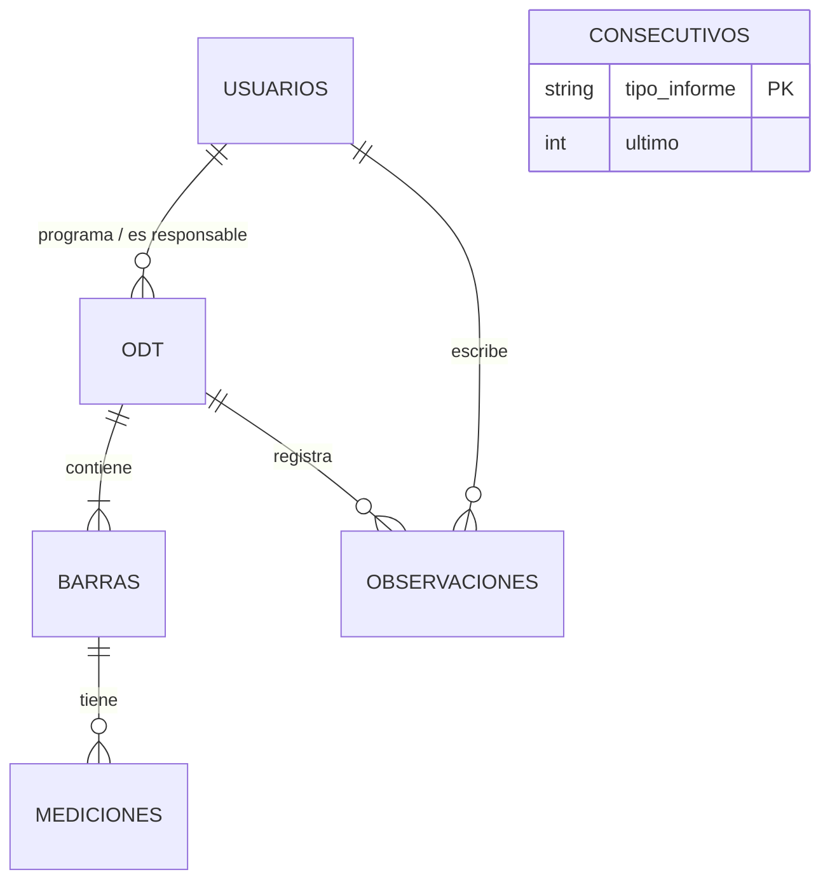

# Diseño de la API – Programa de mejoramiento de toma de datos (Ensayos de aceros)

## 1. Análisis del software (a partir del documento de referencia)
El laboratorio de INGEYMA LTDA recibe barras de acero con una remisión del cliente y debe registrar, calcular y reportar
los ensayos. El software pasa por cinco etapas, cada una con un responsable:

| Etapa del documento | Responsable | Servicios que la cubren |
|---|---|---|
| Inicio de sesión (usuario y clave) | Todos | `POST /auth/login`, `GET /auth/me`, `/usuarios` |
| Programación | Coordinador de laboratorio, analista de informes | `POST/GET/PUT/DELETE /odt` |
| Ejecución del ensayo (3 secciones por barra) | Analista de ensayos asignado | `PUT /odt/{id}/ejecucion`, `POST …/enviar` |
| Registro de fuerzas (fluencia y máxima, kN) | Gerente técnico | `PUT /odt/{id}/fuerzas`, `POST …/observaciones`, `POST …/enviar` |
| Revisión de informes (observaciones, consecutivo, PDF, Excel) | Analista de informes | `/informes/*` |

## 2. Estilo y convenciones
- **REST sobre JSON**, prefijo `/api`, recursos en español y en plural (`/odt`, `/usuarios`, `/informes`).
- Las **acciones del flujo** (enviar, observar, consecutivo) se modelan como `POST` sobre un subrecurso verbo.
- **Códigos HTTP**: 200/201/204 éxito · 400 validación · 401 sin sesión · 403 sin permiso · 404 no existe ·
  409 conflicto de estado · 422 ensayo/fuerzas incompletos.
- **Errores** con formato único `{error:{codigo,mensaje,detalles}}`.
- **Seguridad**: JWT (Bearer), contraseñas con bcrypt, autorización por rol, `helmet` y `cors`.
- **Validación** de entrada con `zod` en una capa previa a la lógica de negocio.

## 3. Arquitectura por capas
```
routes  →  middlewares (auth, roles, validación)  →  controllers  →  services (reglas de negocio)  →  db (SQLite)
                                                                        └─ sharepoint.service (adaptador SharePoint)
                                                                        └─ reportes.service (PDF y Excel)
```

## 4. Modelo de datos

- **odt**: datos de la remisión (código de obra, fecha de recepción, procedencia), datos internos (número ODT, quién programa,
  ensayo, responsable), `estado`, y resultado del informe (`consecutivo`, `codigo_informe`, `ruta_pdf`).
- **barras**: máximo 8 por ODT; Sección 1 (descripción, diámetro, longitud, masa, espaciamiento, nº de resaltes) y fuerzas.
- **mediciones**: Sección 2 (altura de resaltes, lado A/B × resalte 1/2 × 3 mediciones) y Sección 3 (ancho de vena 1/2 × 3 mediciones).
- **observaciones**: hallazgos del gerente o del analista de informes, con etapa y autor.

## 5. Máquina de estados de la ODT
```
PROGRAMADA ──enviar ensayo (con tensión)──▶ PENDIENTE_FUERZAS ──enviar fuerzas──▶ EN_REVISION ──consecutivo──▶ INFORME_PRELIMINAR
    ▲   └──enviar ensayo (sin tensión)────────────────────────────────────────────▲
    └────────── observaciones del gerente (desde PENDIENTE_FUERZAS) o del analista de informes (desde EN_REVISION)
```

## 6. Matriz de permisos
| Servicio | admin | coordinador | analista_informes | analista_ensayos | gerente_tecnico |
|---|:-:|:-:|:-:|:-:|:-:|
| Gestionar usuarios | ✔ | | | | |
| Listar usuarios | ✔ | ✔ | ✔ | | |
| Programar/editar/eliminar ODT | ✔ | ✔ | ✔ | | |
| Consultar ODT | ✔ | ✔ | ✔ | solo las suyas | ✔ |
| Registrar y enviar ensayo | ✔ | | | solo asignado | |
| Registrar fuerzas / observar | ✔ | | | | ✔ |
| Revisar informe, consecutivo, observaciones | ✔ | | ✔ | | |
| Consultar/descargar informes y consolidado | ✔ | ✔ | ✔ | | ✔ |

## 7. Decisiones de diseño y supuestos
1. **Ensayos sin tensión** (Geometría, Doblado) no requieren fuerzas, por lo que pasan directo a `EN_REVISION`.
2. **Envío completo**: la Sección 1 es obligatoria siempre; espaciamiento, altura de resaltes y ancho de vena lo son cuando el ensayo incluye Geometría.
3. **Cálculos** (derivados, no almacenados): altura promedio *h* (12 mediciones), separación *e* (6 mediciones),
   masa lineal (kg/m) = masa(g) / (10 × longitud(cm)) y espaciamiento promedio *s* = longitud(cm)×10 / n.° de resaltes.
   Si el laboratorio usa otra fórmula normativa, solo debe ajustarse `src/utils/calculos.js`.
4. **SharePoint**: el documento indica integración con el SharePoint de INGEYMA. Aquí se simula con una carpeta local
   (`storage/sharepoint/Gestion de informes/Informes preliminares`) detrás de `sharepoint.service.js`; el consecutivo es el
   mayor entre el contador interno y los PDF existentes en esa carpeta. Para producción se reemplaza ese servicio por Microsoft Graph.
5. **Nombre del PDF**: `CódigoObra_TipoInforme_Consecutivo_Preliminar.pdf` (tipo `ENS`, consecutivo de 4 dígitos).
6. El botón **"Regresar"** del documento es navegación del cliente: no requiere servicio.
7. Las ODT no se eliminan una vez enviadas; los usuarios se desactivan (baja lógica) para conservar trazabilidad.
